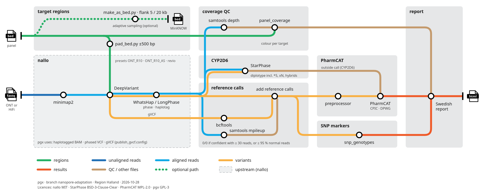

# pgx — ONT Long-Read Adaptation
### Branch: `nanopore-adaptation`
### Maintainer: Lars-Ola Arvidsson, Region Halland
### Based on: [genomic-medicine-sweden/pgx](https://github.com/genomic-medicine-sweden/pgx)
### License: GPL-3

---

## What this is

This branch adapts the `genomic-medicine-sweden/pgx` pharmacogenomics (PGx) pipeline —
originally designed for Illumina short-read WGS data — to support Oxford Nanopore Technology
(ONT) long-read FASTQ input. Both platforms can run in the same pipeline invocation, with
each sample routed to the correct aligner and variant caller based on the `platform` column
in `units.tsv`.

The pipeline is a Snakemake workflow that takes FASTQ files as input and produces clinical
PGx reports as HTML, identifying drug response haplotypes (star alleles) for genes such as
TPMT, CYP2D6, CYP2C19, and DPYD.

---

## Current workflow: nallo → StarPhase → PharmCAT → Swedish report



Since October 2026 the main path uses [nallo](https://github.com/genomic-medicine-sweden/nallo)
for alignment, variant calling and phasing, StarPhase for CYP2D6 and PharmCAT for the other
genes. pgx adds coverage QC, gVCF reference calls, SNP markers and the Swedish report. How
it is built, how to run it, and its current limitations are described in
[`README_pgx_nallo_workflow.md`](README_pgx_nallo_workflow.md). The rest of this document
describes the earlier Clair3-based adaptation, which is still in the pipeline.

---

## Why ONT?

Short-read Illumina sequencing has fundamental limitations for pharmacogenomics:

- **CYP2D6** sits 4 kb from its pseudogene **CYP2D7**. Short reads cannot reliably span the
  boundary, making copy number variation (CNV) and hybrid allele detection unreliable.
- **Complex star alleles** involving multiple variants in phase cannot be resolved with 150 bp
  reads — haplotype phasing requires inference rather than direct observation.
- **Structural variants** (gene duplications, deletions) that determine CYP2D6 activity score
  are missed or mischaracterised by short-read callers.

ONT long reads (5,000–50,000+ bp) resolve all of these directly — reads span the CYP2D6/CYP2D7
boundary, phase is directly observed, and structural variants are detectable from read depth
and split-read signatures.

---

## Key changes from the original pipeline

| Component | Original | This branch |
|---|---|---|
| Alignment module | `hydra-genetics/alignment` (GitHub, bwa mem) | Local `ont_alignment.smk` (minimap2 / bwa) |
| Pre-alignment module | `hydra-genetics/prealignment` (GitHub, fastp) | Removed — fastp not needed for ONT |
| Variant calling module | `hydra-genetics/snv_indels` (GitHub, GATK HaplotypeCaller) | Local `ont_varcall.smk` (Clair3 via Apptainer) |
| Duplicate marking | Picard MarkDuplicates | Removed — not applicable to long reads |
| VCF depth filter | INFO/DP field (GATK format) | FORMAT/DP field (Clair3 format), INFO/DP fallback |
| Platform routing | Illumina only | ONT + Illumina, automatic per-sample routing |
| HTML report | No platform field | Sekvenseringsplattform (ONT / Illumina) |

---

## Architecture overview

```
FASTQ input (ONT or Illumina)
        │
        ▼
units.tsv platform column
        │
        ├─── platform == "Illumina" ──→ bwa mem → samtools sort/index
        │
        └─── platform == "ONT" ──────→ minimap2 -ax map-ont → samtools sort/index
        │
        ▼
BAM: alignment/samtools_merge_bam/{sample}_{type}.bam
        │
        ▼
Clair3 (via Apptainer) ──→ VCF per chromosome
        │
        ▼
bgzip → tabix → bcftools concat ──→ merged VCF
        │
        ▼
variant_filtration.py ──→ filtered VCF
        │
        ▼
GATK VariantAnnotator ──→ annotated VCF
        │
        ▼
detected_variants → clinical_guidelines → interaction_guidelines
        │
        ▼
generate_pgx_report ──→ HTML report + XLSX depth table + clinical recommendations TXT
```

The three hydra-genetics modules (`prealignment`, `alignment`, `snv_indels`) were replaced
with two local rule files (`ont_alignment.smk`, `ont_varcall.smk`). All downstream rules
(variant filtration, annotation, clinical guidelines, report generation) are unchanged from
the original pipeline.

---

## Requirements

### Operating system
Ubuntu 20.04 or later (tested on Ubuntu 24). Not tested on macOS or Windows natively —
use WSL2 on Windows.

### System packages
```bash
sudo apt update
sudo apt install -y git apptainer samtools squashfuse fuse2fs bwa
```

Enable unprivileged user namespaces (required for Apptainer on recent Ubuntu):
```bash
echo 'kernel.apparmor_restrict_unprivileged_userns=0' | \
  sudo tee /etc/sysctl.d/99-userns.conf
sudo sysctl --system
```

### Conda environment
```bash
wget https://repo.anaconda.com/miniconda/Miniconda3-latest-Linux-x86_64.sh
bash Miniconda3-latest-Linux-x86_64.sh

conda config --add channels defaults
conda config --add channels bioconda
conda config --add channels conda-forge
conda config --set channel_priority strict

conda create -n pgx python=3.8
conda activate pgx
pip install -r requirements.txt --break-system-packages
conda install -c bioconda minimap2
conda install -c conda-forge singularity
```

Verify installation:
```bash
snakemake --version   # should print 7.18.0
minimap2 --version
bwa 2>&1 | head -2
```

### Clair3 container
```bash
mkdir -p ~/singularity_images
apptainer pull ~/singularity_images/clair3.sif docker://hkubal/clair3:latest
apptainer exec ~/singularity_images/clair3.sif run_clair3.sh --version
```

Verify available models:
```bash
apptainer exec ~/singularity_images/clair3.sif ls /opt/models/
```

Select the model matching your basecalling chemistry:

| Chemistry | Basecaller | Model path |
|---|---|---|
| R10.4.1 | Dorado SUP | `/opt/models/r1041_e82_400bps_sup_v410` |
| R10.4.1 | Dorado HAC | `/opt/models/r1041_e82_400bps_hac_v410` |
| R10.4.1 | Dorado SUP v5 | `/opt/models/r1041_e82_400bps_sup_v500` |
| R9.4.1 | Guppy SUP | `/opt/models/r941_prom_sup_g5014` |

---

## Running the pipeline

### Step 1 — Activate environment and navigate
```bash
conda activate pgx
cd ~/projects/pgx
git checkout nanopore-adaptation
```

### Step 2 — Prepare your run folder
```bash
mkdir -p ~/projects/pgx_runs/my_run
cd ~/projects/pgx_runs/my_run
cp -r ~/projects/pgx/.tests/integration/config .
mkdir fastq reference
```

Copy your reference genome and index files to `reference/`, and your FASTQ files to `fastq/`.

### Step 3 — Edit `samples.tsv`
One row per patient:
```
sample          tumor_content
KA0822402033    1.0
KA0822402034    1.0
```

### Step 4 — Edit `units.tsv`
One row per sequencing run. Use `platform` to specify `ONT` or `Illumina`:

```
sample          type  platform   barcode  machine  flowcell  lane  fastq1                              fastq2                              adapter
KA0822402033    T     ONT        NANA     ONT001   ONT001    L001  fastq/KA0822402033.fastq.gz         fastq/KA0822402033.fastq.gz         AGATCGG
KA0822402034    T     Illumina   ACTGAC   HV123    FC001     L001  fastq/KA0822402034_R1.fastq.gz      fastq/KA0822402034_R2.fastq.gz      AGATCGG...
```

For ONT samples, `fastq2` must be filled — use the same path as `fastq1` (it is ignored).

### Step 5 — Edit `config/config.yaml`
Update the Clair3 model path to match your chemistry:
```yaml
clair3:
  model_path: "/opt/models/r1041_e82_400bps_sup_v410"
  container: "/home/your-username/singularity_images/clair3.sif"
  threads: 8
```

### Step 6 — Dry run
```bash
snakemake -s ~/projects/pgx/workflow/Snakefile \
  -n --use-singularity \
  --configfile config/config.yaml
```

Confirm the job list looks correct — both alignment jobs should appear with the right mode
(ONT or Illumina).

### Step 7 — Run
```bash
snakemake -s ~/projects/pgx/workflow/Snakefile \
  --use-singularity \
  --cores 6 \
  --configfile config/config.yaml
```

### Step 8 — View results
```bash
ls results/dna/pgx/
xdg-open results/dna/pgx/{sample}_T.pgx_report.html
```

---

## Sample naming

The `sample` field in `samples.tsv` and `units.tsv` becomes the identifier used in all
output file names. Swedish clinical LIDs are fully supported:

- `KA0822402033` — letters followed by numbers ✅
- `6902006428` — numbers only ✅
- `23-12345` — **avoid hyphens** — use underscores instead: `23_12345`

Check wildcard constraints if you are unsure:
```bash
grep "wildcard_constraints" ~/projects/pgx/workflow/rules/common.smk
```

---

## Output files

For each sample the pipeline produces:

```
results/dna/pgx/
├── {sample}_T.pgx_report.html                        # Clinical HTML report
├── {sample}_T.pgx_clinical_recommendations.txt       # Text recommendations
├── {sample}_T.pgx_depth_table.xlsx                   # Coverage table
└── additional_files/
    ├── {sample}_T.detected_variants.csv              # Detected PGx variants
    ├── {sample}_T.depth_of_baits.gdf                 # Bait region coverage
    └── {sample}_T.depth_at_missing_annotated.gdf     # Coverage at uncalled positions
```

The HTML report includes:
- **Provdetaljer**: Prov ID, Sekvenserings ID, Sekvenseringsplattform, dbSNP, reference path
- **Kliniska rekommendationer**: drug response recommendations per gene
- **Detekterade varianter**: table of detected PGx variants with rsIDs
- **Läsdjup**: coverage depth table across target regions

---

## ⚠️ Known limitations

These apply to the Clair3 path below. For the nallo path, see
`README_pgx_nallo_workflow.md`, section 5.

### 1. One platform per sample per run

If the same `sample`+`type` appears in both an Illumina row and an ONT row in `units.tsv`,
the two alignment jobs will write to the same BAM path and overwrite each other.

**Workaround:** include only one platform per sample per run. To compare results, run the
pipeline twice — once per platform — keeping results in separate output directories.

**Planned fix:** encode platform in the BAM path (`{sample}_{type}_{platform}.bam`) with
a downstream handoff rule so all subsequent steps remain platform-agnostic.

### 2. Clair3 used for all samples regardless of platform

Clair3 is currently applied to both ONT and Illumina samples. It is optimised for ONT
and uses an ONT model even when processing Illumina reads. This is acceptable for
cross-platform comparison testing but not ideal for production Illumina use.

**Planned fix:** platform-aware variant calling — route Illumina samples to GATK
HaplotypeCaller and ONT samples to Clair3.

### 3. System samtools used for alignment

The conda-installed samtools (0.1.19) in the `pgx` environment is too old for modern
samtools syntax. The alignment rule explicitly calls `/usr/bin/samtools` (v1.22.1).
Ensure `/usr/bin/samtools` is version ≥ 1.17 on any new machine.

### 4. Gene panel covers TPMT only (chr6)

The reference genome, BED files, and clinical guidelines currently target only TPMT on
chromosome 6. Expanding to other genes requires a full reference genome and updated BED
and haplotype definition files.

### 5. No CYP2D6 CNV calling yet

CYP2D6 structural variants and copy number changes are not yet detected. This is a planned
major feature addition.

---

## Validated test run

The pipeline has been validated end-to-end with:
- **HD832_T** (Illumina): real paired-end FASTQ from the bundled test data
- **NANOPORE_T** (ONT): synthetic reads generated from the chr6 TPMT reference region

Both samples produced complete HTML clinical reports in a single 45-step pipeline run.

Real ONT data from the ONT open data S3 bucket
(`s3://ont-open-data/pgx_as_2025.07`) has been identified as the next validation dataset.
CYP2D6 tagged BAMs for 8 samples are available there, enabling validation against known
published genotypes.

---

## Roadmap

### Near term
- [ ] Fix platform-in-BAM-path for true parallel Illumina+ONT per sample
- [ ] Platform-aware variant calling (HaplotypeCaller for Illumina, Clair3 for ONT)
- [ ] Real ONT FASTQ validation against known CYP2D6 genotypes
- [ ] Expand gene panel to CYP2D6 (chr22), CYP2C19 (chr10), DPYD (chr1)

### CYP2D6 features (major)
- [ ] CYP2D6 CNV calling with Sniffles2 on ONT BAMs
- [ ] Paralog-aware CYP2D6/CYP2D7 resolution (Paraphase or equivalent)
- [ ] CYP2D6 section in HTML report (`html#CYP2D6`) with:
  - HGVS nomenclature for detected variants
  - Gene structure graphic showing CYP2D6 relative to CYP2D7
  - Copy number estimate
  - Star-allele call and activity score

### Infrastructure
- [ ] Full reference genome support (currently chr6 only)
- [ ] Conda environment pinning for long-term reproducibility
- [ ] Documentation of Clair3 model selection for different chemistries

---

## Git branch summary

All work is on the `nanopore-adaptation` branch. The `develop` branch contains the
original unmodified pipeline.

Key commits:
- Replace hydra-genetics modules with local ONT rules
- Add platform-aware alignment (minimap2 / bwa)
- Integrate Clair3 via Apptainer
- Fix variant_filtration.py for Clair3 VCF format
- End-to-end validation on both platforms
- Rename nanopore → ONT throughout
- Add Sekvenseringsplattform to HTML report

---

## Files changed on this branch

| File | Change |
|---|---|
| `workflow/Snakefile` | Removed 3 module blocks, added 2 local includes |
| `workflow/rules/ont_alignment.smk` | New — platform-aware alignment (minimap2 / bwa) |
| `workflow/rules/ont_varcall.smk` | New — Clair3 variant calling + VCF processing |
| `workflow/scripts/variant_filtration.py` | DP field lookup fixed for Clair3 VCF format |
| `workflow/rules/generate_pgx_report.smk` | Added `units_file` parameter |
| `workflow/scripts/generate_pgx_report.py` | Added platform lookup and template variable |
| `.tests/integration/reference/html_template.html` | Added Sekvenseringsplattform row |
| `.tests/integration/config/config.yaml` | Replaced Illumina tool config with ONT/Clair3 |
| `.tests/integration/samples.tsv` | Added NANOPORE test sample |
| `.tests/integration/units.tsv` | Added ONT unit row, renamed platform value |
| `README_nanopore_adaptation.md` | This file |