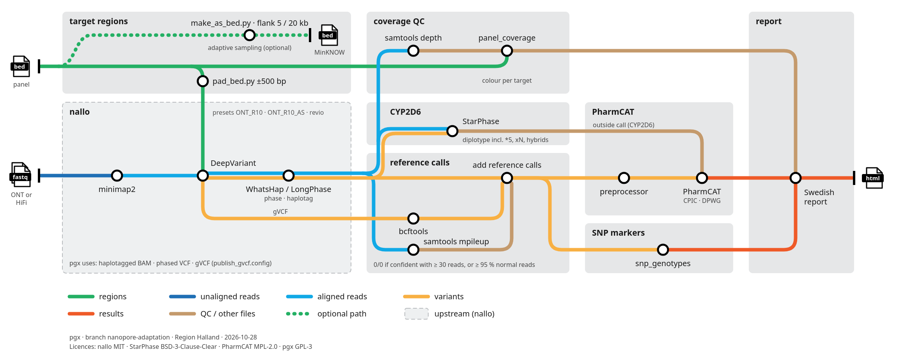

# pgx on long reads: nallo → StarPhase → PharmCAT → Swedish report

Branch `nanopore-adaptation` of [genomic-medicine-sweden/pgx](https://github.com/genomic-medicine-sweden/pgx).
Maintainer: Lars-Ola Arvidsson, Region Halland. Status: development, **not validated for clinical use**.
Last updated 2026-10-29.



This document is for a bioinformatician who wants to understand how the workflow is put
together, run it, or review it. For the earlier Clair3-based ONT adaptation of pgx, see
`README_nanopore_adaptation.md`.

---

## 1. Goal and scope

A pharmacogenomics (PGx) pipeline for **ONT long reads** that small regional labs can run.
PacBio HiFi is kept possible: the platform is set per sample, and only the upstream
settings change. The planned clinical input (2027) is a long-read-adapted Qiagen hybrid
capture panel with 49 biomarkers. CYP2D6 is double-tiled across the whole locus.

Output is one Swedish HTML report per sample:
- star-allele diplotypes and phenotypes per gene
- CPIC/DPWG recommendations (Swedish text where available)
- the CYP2D6 call
- plain genotypes for markers PharmCAT does not cover
- read-depth QC per gene
- PharmCAT positions outside the enriched panel region, listed separately

**Hard constraint:** everything in the clinical path must be redistributable through GMS.
Only MIT, GPL-3, Apache, BSD-style or MPL-2.0 licences are allowed.

| Tool | Role | Licence |
|---|---|---|
| [nallo](https://github.com/genomic-medicine-sweden/nallo) (Nextflow) | alignment, SNV calling, phasing | MIT |
| [StarPhase](https://github.com/PacificBiosciences/pb-StarPhase) 1.5.0 | CYP2D6 diplotype | BSD-3-Clause-Clear |
| [PharmCAT](https://pharmcat.org) 3.4.0 | all other PharmCAT genes, phenotypes, guidelines | MPL-2.0 |
| pgx (Snakemake) | coverage QC, reference calls, SNP markers, report | GPL-3 |

`epi2me-labs/wf-pgx` and Chinook are under the ONT Public License (research only). They
are deliberately **not** used, though they may be used for comparison. Paraphase and Aldy
were evaluated and dropped (see §6).

---

## 2. Architecture

Two workflows run one after the other:

1. **nallo** (unchanged upstream, run with our parameter file). Inputs are FASTQ/BAM, GRCh38
   with `chr` names and the panel BED. It produces:
   - haplotagged BAM (minimap2 + WhatsHap/LongPhase)
   - phased SNV VCF (DeepVariant)
   - DeepVariant gVCF chunks (only with `config/nallo/publish_gvcf.config`, because nallo does
     not publish the gVCF by default)
   - Sniffles2 SV VCF (not used by pgx)
2. **pgx** (Snakemake 7) reads those files directly from nallo's output folder
   (`starphase.bam_source: "nallo"`) and does the rest.

Everything after nallo is platform-independent. The platform (`ONT` or `PACBIO` in
`units.tsv`) only selects the coverage colour thresholds.

### pgx rules (nallo path)

| Rule file | Rules | What it does | Main output |
|---|---|---|---|
| `starphase_cyp2d6.smk` | `starphase_diplotype`, `starphase_parse_cyp2d6` | `pbstarphase diplotype` on haplotagged BAM + phased VCF. Also writes `--pharmcat-tsv` | `results/starphase/{s}_{t}_starphase.json`, `_pharmcat.tsv`, `_cyp2d6_result.csv` |
| `panel_coverage.smk` | `panel_depth`, `panel_coverage` | `samtools depth -a` over the panel targets. Colour per target from the **lowest depth at a clinical (PharmCAT) position** inside it | `results/coverage/{s}_{t}.panel_depth.tsv.gz`, `.panel_coverage.tsv` |
| `pharmcat_positions.smk` | `pharmcat_positions_vcf`, `pharmcat_positions_bed` | Extracts PharmCAT's positions from the container in use; `"pharmcat"` in the config selects the BED | `results/gvcf/pharmcat_positions.vcf`, `.bed` |
| `gvcf_reference_calls.smk` | `reference_positions`, `gvcf_expand`, `reference_pileup`, `add_reference_calls`, `bgzip_reference_calls` | Adds explicit 0/0 or ./. records at every PharmCAT and SNP-marker position the variant VCF lacks (see §3) | `results/gvcf/{s}_{t}.with_refcalls.vcf.gz` |
| `snp_genotypes.smk` | `snp_genotypes` | Genotypes markers outside PharmCAT from a marker table (HGVS, zygosity, copies of the defining allele). Indels are normalised against the reference before matching | `results/snp/{s}_{t}.snp_genotypes.tsv` |
| `off_target.smk` | `enriched_regions`, `pharmcat_enriched_vcf`, `pharmcat_allele_positions`, `off_target_calls` | Splits PharmCAT positions into enriched (panel targets ±`enriched_pad`, fed to PharmCAT) and outside (listed per position, see §3) | `results/pharmcat/{s}_{t}.enriched.vcf.gz`, `results/off_target/{s}_{t}.off_target.tsv` |
| `pharmcat.smk` | `pharmcat_preprocess`, `pharmcat_outside_calls`, `pharmcat_run`, `generate_pharmcat_report` | PharmCAT in two stages, with StarPhase's CYP2D6 as an outside call, then the Swedish report | `results/pharmcat/*.json`, `results/report/{s}_{t}.pgx_report.html` |

Include order in `workflow/Snakefile`: … `starphase_cyp2d6`, `pharmcat_positions`, `panel_coverage`,
`gvcf_reference_calls`, `snp_genotypes`, `off_target`, `pharmcat`. All of them are off by default in
`config/config.yaml` and are switched on per run.

Scripts are in `workflow/scripts/`:
- `gvcf_reference_calls.py`
- `panel_coverage.py`
- `snp_genotypes.py`
- `off_target_calls.py`, `pharmcat_allele_positions.py`
- `generate_pharmcat_report.py`
- `pharmcat_report_data.py`

The report template is `config/templates/html_template_pharmcat.html` (Jinja2). Report
sections:
- Provdetaljer
- Sammanfattning per gen
- Kliniska rekommendationer
- CYP2D6
- Övriga markörer
- Utanför panelens mål (only with `off_target.enabled`)

### PharmCAT invocation

`pharmcat_pipeline` has no outside-call option, so the two stages run separately inside
the 3.4.0 container:

```
pharmcat_vcf_preprocessor -vcf <with_refcalls.vcf.gz> ...
java -jar /pharmcat/pharmcat.jar -vcf <preprocessed> -po <outside_calls.tsv> -reporterJson
```

`pharmcat.outside_call_genes` (default `["CYP2D6"]`) filters StarPhase's TSV to the genes
StarPhase should call. **Never** use `--absent-to-ref` / `--unspecified-to-ref`: they turn
"not seen" into "normal". Reference genotypes come only from the gVCF and read evidence
(§3).

---

## 3. Design decisions worth knowing

### Why reference calls are needed
A VCF only lists variants, so a position missing from it can mean "normal" or "not
sequenced". On panel data PharmCAT then reports all-reference genes (DPYD, NUDT15, NAT2,
G6PD, …) as "No Result". `gvcf_reference_calls.py` therefore expands nallo's gVCF at every
wanted position and adds one record per position that the variant VCF lacks:

1. Every base of the position is a confident 0/0 in the gVCF and depth ≥ `min_depth`
   → **0/0**. `min_depth` is the platform's orange threshold: 30 for ONT, 10 for HiFi.
2. Otherwise, the **read rule**: at least 30 reads, and at least 95% of them "normal"
   → **0/0**, with `INFO/PGX_READRULE=<fraction>;PGX_READS=<n>`. A read is normal if it
   has the reference base at every base of the position and no insertion or deletion
   inside it. The reads come from `samtools mpileup -B -Q 0 -q 5 --output-QNAME`.
3. Otherwise → **./.**, reported as "not assessable" (label shows the cause: low depth or
   uncertain call).

In the PharmCAT gene summary, positions called by the read rule are listed per gene as
"Normal enligt läsandel: rsID (x % av n läsningar)", in neutral bold, not as a warning.

DeepVariant `RefCall` records with GT 0/0 are kept. A 0/0 record only vouches for the
position it starts at: a rejected deletion one base earlier (e.g. AG>A at chr7:99762046)
no longer hides the SNV at the next base. That had made CYP3A4\*13 and CYP2C9\*88
disappear on HG00276; they now go through the read rule (85–86% normal, so still ./.). `RefCall` ./. records at wanted
positions are replaced by the decision above. An attempt to also treat `RefCall` 0/0 as
uncertain changed CYP2C9 calls on HG00276 and was reverted.

### PharmCAT quirk: indel reference records
PharmCAT's preprocessor **silently discards indel reference records whose ALT is "."**.
On HG00276 that made DPYD \*3 and \*7 "not tested" even though the gVCF had confident 0/0
calls. That affected 43 positions. Reference records at indel positions therefore carry
PharmCAT's own ALT alleles, read from `/pharmcat/pharmcat_positions.vcf` inside the
container (rule `pharmcat_positions_vcf` in `pharmcat_positions.smk`).

### SNV calling region: targets ±500 bp, plus every PharmCAT position ±100 bp
nallo calls SNVs in `snv_call_regions`, made with `config/nallo/pad_bed.py`, which takes
one or more BED/padding pairs:

```
python3 config/nallo/pad_bed.py panel_targets.bed 500 public_panel_targets.bed 0 > call_regions.bed
```

The ±500 bp around the panel targets is needed. Without padding:
- CYP3A4\*2 (next to a target) was reported as \*1/\*1
- UGT1A1\*28 was lost, because the indel's VCF anchor base lies outside the target

The public BED (every PharmCAT position and SNP marker ±100 bp, Step 0) is added so that
long reads reaching beyond the baits also get calls. On the Twist design this grows the
calling region from 194 kb to 227 kb.

### Off-target positions ("Utanför panelens mål")
The panel is kept slim so that several samples fit on one MinION flow cell. PharmCAT
therefore only gets positions in the **enriched region**: panel targets
±`off_target.enriched_pad` bp (default 500, the same region as before), so diplotypes rest
on enriched positions only. Every other PharmCAT position gets its own row in a separate
report section, never fed into a diplotype:

| Status | When |
|---|---|
| Variant | a call other than 0/0; flagged "kontrollera manuellt" |
| Normal | 0/0 with ≥ 30 reads, or by the read rule |
| Ej bedömbar (osäkert anrop) | ≥ 30 reads, but no confident call |
| Lågt läsdjup | < 30 reads; still shows what was found (DeepVariant's genotype and share of normal reads), in red |
| Ej anropad | reads, but outside nallo's calling region |
| Ej täckt | no reads |

Outside-call genes (CYP2D6) are skipped. Genes with no panel target at all (e.g. RYR1,
CFTR on the Twist design) are listed only where reads exist. The alleles defined at each
position are read from the allele definitions inside `pharmcat.jar`. The gene table
links to the section ("Utanför panelen: n pos."). Requires `pharmcat`, `panel_coverage`
and `reference_calls`; off by default.

SNP markers follow the same split: markers outside the enriched region get their own
table in the SNP section ("Markörer utanför panelens mål"), with the same rules. Their
depth comes from the read-rule pileup, because `samtools depth` only covers the panel
targets. On the Twist design all 37 markers lie inside the targets, so the table is empty
there. A test with the MTHFR, F2, F5 and ALDH2 targets removed listed those 5 markers with
the same genotypes as before (MTHFR c.1286A>C heterozygous, flagged for review).

On HG00276 the PharmCAT result is identical with the section switched on; 32 positions
are listed (CYP3A4 1, CYP4F2 9, G6PD 22; 7 G6PD positions with 12 reads shown as
"Lågt läsdjup"). Those reads were extracted from WGS, so off-target depth on real capture
data will be lower.

### Coverage colours (per platform, configurable)

| Platform | Green | Pale green | Orange | Red | Black |
|---|---|---|---|---|---|
| ONT | ≥ 100 | 50–99 | 30–49 | 1–29 | 0 |
| PACBIO (HiFi) | ≥ 41 | 20–40 | 10–19 | 1–9 | 0 |

The orange lower limit is also the minimum depth for a reported 0/0.

### SNP marker table
Markers outside PharmCAT are listed in a TSV. Its format is documented in `snp_genotypes.py`
and the table header; it includes VEP-style alleles, HGVS per allele, the clinical allele
and the defining allele. The current table has 37 markers (MTHFR, F2, F5, ALDH2, IFNL4,
CYP3A4\*1B, CYP3A5\*7, …). Indel markers are normalised (anchor base, left-aligned) like
`bcftools norm`.

### Other
- **CYP2D6:** StarPhase's call is used as-is. Paraphase was dropped: it gives copy number
  and gene copies but no star alleles, and it is HiFi-first. The code is parked on branch
  `paraphase-research`.
- **HLA:** HLA-A/B are not reported (StarPhase HLA is not validated).
- **Guideline text:** where no Swedish text exists, the English CPIC/DPWG text is shown.

---

## 4. Running it

### Requirements
- Linux, Apptainer/Singularity, Nextflow (for nallo), conda env `pgx` (Snakemake 7.18,
  Python 3.8; see `README_nanopore_adaptation.md`).
- samtools ≥ 1.17 on the system path. The `pgx` env contains samtools 0.1.19, so the
  config points at `/usr/bin/samtools`.
- Containers: `pgkb/pharmcat:3.4.0` (bundles its own reference, no runtime downloads),
  pbstarphase 1.5.0.
- Reference data:
  - GRCh38 with `chr` names + `.fai`
  - StarPhase database (pre-built `pbstarphase_20251002.json` from the pb-StarPhase repo;
    `pbstarphase build` does not work offline)
  - `hs38.PAR.bed` for nallo
- Panel and text files (all in the repo except a capture-design BED):

| File | Where to get it |
|---|---|
| Panel target BED (BED4, name `GENE` or `GENE\|rsID`) | Your capture design, or build a public one with `config/panel/make_public_panel_bed.py` (below) |
| PharmCAT positions | Generated from the PharmCAT container: set `"pharmcat"` in the config (rule `pharmcat_positions_bed`) |
| SNP marker table | `config/templates/snp_markers.example.tsv` (37 markers, draft) |
| Swedish guideline texts | `config/templates/swedish_guidelines.draft.tsv` (22 rows, draft, not approved); format described in `swedish_guidelines.example.tsv`. Without it the report shows English CPIC/DPWG text |

### Step 0: panel target BED (only without a capture-design BED)
Our own panel BED is the Region Örebro län Twist design and is not in the repo. A BED from
public sources only:

```
apptainer exec pharmcat_3.4.0.sif cat /pharmcat/pharmcat_positions.vcf > pharmcat_positions.vcf
python3 config/panel/make_public_panel_bed.py --fai GRCh38_chr.fasta.fai \
  --pharmcat-vcf pharmcat_positions.vcf \
  --markers config/templates/snp_markers.example.tsv \
  --starphase-db pbstarphase_20251002.json > public_panel_targets.bed
python3 config/nallo/pad_bed.py public_panel_targets.bed 500 > public_panel_targets_pad500.bed
```

It contains every PharmCAT position and SNP marker ±100 bp, merged per gene, plus the whole
CYP2D6 locus as StarPhase defines it (REP6 … CYP2D7, chr22:42,123,191–42,145,903). On
GRCh38 that gives 243 targets, 92 kb. Give `public_panel_targets.bed` to nallo as
`target_regions` and to pgx as `panel_coverage.target_bed`, and the `_pad500` file to nallo
as `snv_call_regions` (or use the two-pair `pad_bed.py` form from §3). It has no targets for ACE, TYMS or HLA (no PharmCAT positions or
markers there).

Tested 2026-10-28 on HG00276: with the public BED and generated PharmCAT positions on the
pgx side, all PharmCAT results, the CYP2D6 call and the SNP section were identical to the
run with the Örebro BED. The nallo step was not rerun; it used the existing Örebro-based
output. Only the coverage colours differ, because the targets differ.

### Step 1: nallo
Copy `config/nallo/params_ont_panel.yaml` and fill in the paths. Then:

```
nextflow run genomic-medicine-sweden/nallo -profile singularity \
  -c config/nallo/publish_gvcf.config [-c local_resources.config] \
  -params-file params_ont_panel.yaml -resume
```

Notes:
- **Preset:** `ONT_R10`, `ONT_R10_AS` (adaptive sampling) or `revio`/`pacbio` (HiFi).
- **Sample naming:** the samplesheet sample ID must be `{sample}_{type}` as pgx uses it
  (e.g. `HG00276_T`).
- **Sex:** with the sex check skipped, sex must be 1 or 2.
- **CPU cap:** on machines with fewer than 12 cores, cap resources (`resourceLimits`).
- **Shutdown hang:** the Nextflow JVM can hang after "Pipeline completed"; watch the log.

### Step 2: pgx
In a run folder, create `samples.tsv` and `units.tsv` (`platform` = `ONT` or `PACBIO`) and
a run config that switches the modules on. The old pgx code still reads its own reference
files when the workflow starts, so the run folder also needs `config/` and `reference/`;
link them to `.tests/integration/config` and `.tests/integration/reference`. The base config
`config/config.yaml` has `/path/to/` placeholders, and the linked test config has paths from
the development machine, so set every path below in your run config. This is
the HG00276 example, with paths shortened:

```yaml
samples: "samples.tsv"
units: "units.tsv"
starphase:  {enabled: true, bam_source: "nallo", nallo_outdir: "/path/nallo_results", nallo_alignment_format: "bam",
             container: "/path/starphase.sif", database: "/path/pbstarphase_20251002.json",
             reference: "/path/GRCh38_chr.fasta"}
pharmcat:   {enabled: true, container: "/path/pharmcat_3.4.0.sif", outside_call_genes: ["CYP2D6"],
             swedish_guidelines: "/path/swedish_guidelines.tsv", guideline_sources: ["CPIC", "DPWG"]}
panel_coverage: {enabled: true, target_bed: "/path/panel_targets.bed",
                 clinical_positions: "pharmcat",
                 samtools: "/usr/bin/samtools", min_mapq: 0, thresholds: {ONT: [100, 50, 30, 1]}}
snp_markers:     {enabled: true, table: "/path/pgx/config/templates/snp_markers.example.tsv"}
reference_calls: {enabled: true, positions: ["pharmcat"],
                  read_rule: {enabled: true, min_reads: 30, min_fraction: 0.95, min_mapq: 5}}
off_target:      {enabled: true, enriched_pad: 500}
```

Then, from the run folder, dry-run first:

```
conda run -n pgx snakemake -s /path/pgx/workflow/Snakefile \
  --configfile config/config.yaml run.yaml --cores 2 --use-singularity \
  results/report/HG00276_T.pgx_report.html -n
```

Run the same command without `-n` for the real run. `--use-singularity` is required.

### Tests
Unit tests (7 files, 56 tests):

```
cd workflow/scripts && conda run -n pgx python -m unittest discover -p '*_test.py'
```

Plain `python -m unittest` finds 0 tests. The helper scripts have their own tests:
`config/adaptive_sampling/make_as_bed_test.py` and
`config/panel/make_public_panel_bed_test.py` (run `python3 -m unittest` in each folder).
The integration test in `.tests/integration` covers the original pgx path (StarPhase and the nallo modules disabled).

### Adaptive sampling BED (optional)
`config/adaptive_sampling/make_as_bed.py` builds a MinKNOW target BED from the panel BED,
PharmCAT positions and marker table. It adds a flank on both sides (5 kb for capture
libraries, 20 kb for native gDNA). Not yet tested on a real run.

---

## 5. Current limitations

**Validation**
- End to end on **one sample** (HG00276, ONT). The panel reads were extracted from a WGS
  BAM, so this is not real hybrid-capture data. Every PharmCAT gene matches the original
  WGS analysis of the same sample. That is a consistency check, **not a truth set**.
- CYP2D6 (StarPhase) is checked against GeT-RM truth on 2 structural cases only:
  - HG00276 \*4/\*5 ✅
  - HG001 \*3/[\*68+\*4] ✅
  - Duplications and other hybrids on ONT are untested.
- HiFi: thresholds are configured, but no HiFi sample has been run.

**Calls not assessable on ONT (HG00276)**
- Most "Ej testade alleler" are ONT noise at in-panel positions with plenty of reads
  but only 59–94% normal reads (below the 95% rule; DPYD, CYP2C9, CYP3A4, NUDT15, TPMT,
  SLCO1B1). More depth or a wider panel does not fix that.
- IFNL4 rs11322783 (ΔG): DeepVariant gives ./. GQ 1, and only 84% of reads are normal
  across the three bases (ONT noise next to a G run).
- 7 DPYD positions stay below the 95% rule: c.1682G>T, c.3049G>A, \*9B, c.1615G>A, c.61C>T,
  c.62G>A, c.632A>G (82–90% normal reads).

**Report**
- The Swedish guideline texts and the marker table are drafts. The texts are not approved
  by the interpretation group, and the CYP2D6 texts are not reviewed at all.
- There is no "journal version" (genotypes without drug text).

**Engineering**
- The Region Örebro län panel BED is not in the repo, because it is not yet clear whether
  the design can be redistributed. The public BED (Step 0) is the substitute.
- The run folder needs `config/` and `reference/` from the old pgx path even for the nallo
  path (`common.smk` reads them at start-up).
- `.tests/integration/config/config.yaml` still holds container paths from the development
  machine (the integration test needs real paths). Change them to your own before running
  the integration test.
- Snakemake 7 does not rerun after a script edit, and does not rebuild a missing
  intermediate while the final report exists. Request the intermediate target explicitly.
  `--forcerun add_reference_calls` fails (MissingInputException in the old alignment
  rules).
- `starphase.bam_source: "pgx"` (pgx's own Clair3 output) does not work. That VCF is
  unphased and temporary, and the BAM is not haplotagged. Use nallo.
- One platform per sample per run.
- nallo needs an extra config to publish the gVCF.

---

## 6. Things tried and dropped

| Tool | Why not |
|---|---|
| Paraphase | No star alleles, output not usable by StarPhase, HiFi-first (branch `paraphase-research`) |
| Aldy 4 | Documented hang on ONT CYP2D6 (GitHub issue #73) |
| `pbstarphase build` | Crashes in v2.2.0. v1.5.0 needs the PharmVar API (blocked on our network). We use the pre-built database |
| epi2me wf-pgx, Chinook | ONT Public License: research use only |
| PharmCAT `--absent-to-ref` | Turns "not sequenced" into "normal" |

---

## 7. To do

- IFNL4 and the remaining DPYD positions: better ONT calling, or accept "not assessable".
- Truth-set validation of non-CYP2D6 genes (GeT-RM / GIAB samples).
- More CYP2D6 structural cases on ONT (duplications, CYP2D6/2D7 hybrids).
- HLA validation before reporting HLA-A/B.
- Journal version of the report.
- Run on real hybrid-capture data (2027). Compare capture vs adaptive sampling vs both.
- Suggest to nallo (GMS) that the gVCF be published by default.
- Longer term, only if StarPhase proves insufficient: an open-source ONT CYP2D6/CYP2D7
  resolver.
